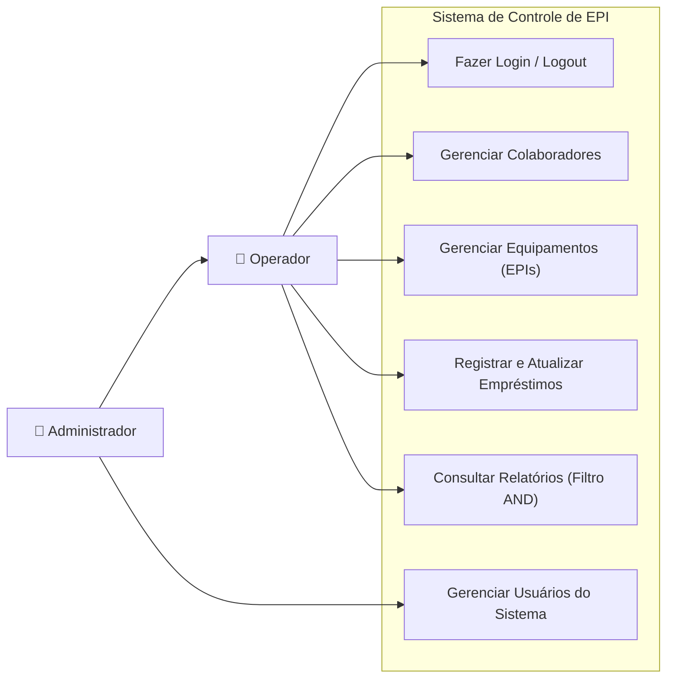
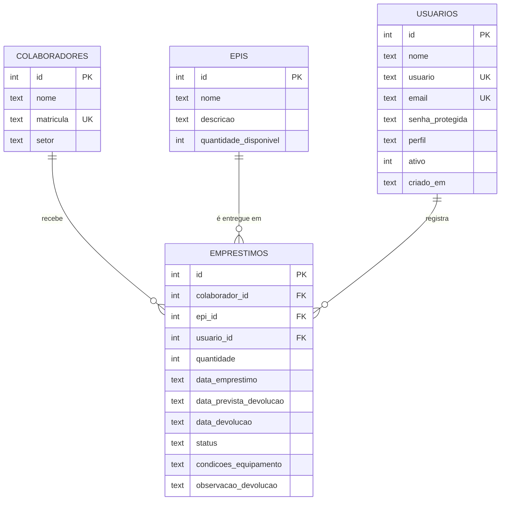
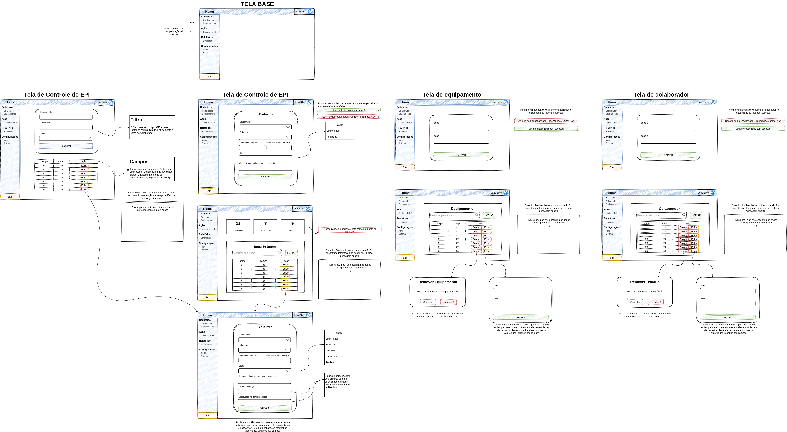

# Controle de EPI — Sistema de Gerenciamento e Empréstimos

Sistema corporativo para controle de Equipamentos de Proteção Individual (EPI), gestão da equipe de colaboradores, controle de retiradas, devoluções e vistorias de segurança do trabalho para empresas de construção civil.

---

## Informações do Projeto

- **Equipe de Desenvolvimento:**
  - José Augusto da Silva Bertolino Falcão
  - Taiane Silva de Oliveira
- **Curso:** Técnico em Desenvolvimento de Sistemas
- **Disciplina:** Desenvolvimento de Sistemas
- **Atividade Avaliativa:** Sistema de Gerenciamento de EPIs

---

## Acesso e Autenticação (Real)

O sistema conta com autenticação real baseada em **Nome de Usuário** e **Senha**, com controle de sessão seguro (`HttpOnly` cookie) e hash criptográfico SHA-256 com salt.

O administrador padrão é gerado automaticamente na inicialização com uma conta genérica:

| Campo | Credencial |
| :--- | :--- |
| **Usuário** | `admin` |
| **Senha** | `admin123` |

Novos usuários com perfil de **Administrador** ou **Operador** podem ser criados, editados e gerenciados no módulo de **Gestão de Usuários**.

---

## Planejamento do Sistema

### 1. Requisitos Funcionais (RF)
- **RF01:** Permitir login e logout no sistema com usuário e senha.
- **RF02:** Cadastrar, listar, pesquisar por nome, editar e excluir colaboradores.
- **RF03:** Cadastrar, listar, pesquisar por nome, editar e excluir equipamentos (EPIs) com controle da quantidade disponível em estoque.
- **RF04:** Registrar empréstimos e fornecimentos de EPIs vinculando colaborador e equipamento, dando baixa automática no estoque.
- **RF05:** Atualizar o status do empréstimo (`Emprestado`, `Fornecido`, `Devolvido`, `Danificado`, `Perdido`), registrando data e observação de devolução e repondo o estoque quando devolvido.
- **RF06:** Consultar relatórios de empréstimos aplicando filtros simultâneos (tipo `AND`) por colaborador, equipamento e status.
- **RF07:** Gerenciar usuários do sistema (criar, editar, ativar/desativar e excluir), restrito ao perfil Administrador.

### 2. Requisitos Não Funcionais (RNF)
- **RNF01 (Usabilidade):** Interface simples e intuitiva com menu lateral fixo, alertas de sucesso/erro em todas as operações e janela de confirmação antes de excluir registros.
- **RNF02 (Persistência):** Armazenamento permanente dos dados em banco de dados relacional SQLite (`dados/controle_epi.db`).
- **RNF03 (Segurança e Controle de Acesso):** Senhas protegidas com hash e acesso restrito a usuários autenticados, separando permissões de Operador e Administrador.
- **RNF04 (Integridade dos Dados):** Bloqueio de exclusão de colaboradores, EPIs ou usuários que possuam histórico de empréstimos, além da validação de datas de devolução.
- **RNF05 (Portabilidade):** Execução padronizada via Node.js ou container Docker.

### 3. Diagrama de Casos de Uso



### 4. Modelagem do Banco de Dados (DER)

O banco de dados possui 4 tabelas principais relacionadas por chaves estrangeiras (`colaborador_id`, `epi_id` e `usuario_id`):



### 5. Protótipo de Telas (Wireframe)

O planejamento visual das telas (Tela Base, Colaboradores, Equipamentos, Empréstimos e Relatórios) está disponível no arquivo `wireframe.png`:



---

## Módulos e Funcionalidades

### 1. Gestão de Usuários (Administração)
- Cadastro de novos operadores e administradores com login único (`@usuario`), nome e senha protegida.
- Edição de cadastros existentes com opção de redefinição de senha e ativação/desativação.
- Proteção da conta raiz: o administrador principal (`admin`) é protegido contra exclusão ou desativação acidental.
- Proteção de integridade: usuários vinculados a histórico de empréstimos não podem ser excluídos.

### 2. Cadastro de Colaboradores
- Cadastro com validação de campos obrigatórios: Nome completo, Matrícula única (numérica) e Setor.
- Busca em tempo real por nome com normalização de acentuação em pt-BR.
- Edição e exclusão com diálogo modal de confirmação.

### 3. Catálogo de Equipamentos (EPIs)
- Controle de estoque físico e disponibilidade de itens.
- Cadastro de itens com Nome, Quantidade disponível e Certificado de Aprovação (C.A.).
- Proteção de exclusão: bloqueia remoção de EPIs com histórico de empréstimo.

### 4. Controle de Empréstimos e Vistorias
- **Painel de Indicadores (KPIs):**
  - **Itens Disponíveis:** Total em estoque para novas entregas.
  - **Empréstimos Ativos:** Equipamentos atualmente em uso.
  - **Prazos Vencidos:** Alerta de devoluções com data limite expirada.
  - **Total de Colaboradores:** Efetivo cadastrado.
- **Emissão de Empréstimo:** Associação entre Colaborador e EPI, registro de condições na entrega, data de empréstimo e previsão de devolução (validada obrigatoriamente para ser posterior à entrega).
- **Atualização de Status e Vistoria:**
  - Status gerenciados: `Emprestado`, `Fornecido`, `Devolvido`, `Danificado`, `Perdido`.
  - Dados de entrega originais bloqueados contra edição para preservar o histórico.
  - Exibição dinâmica de campos de **Data da Devolução** e **Observações / Avarias** para encerramento de empréstimo.

### 5. Relatórios com Filtro Combinatório (AND)
- Filtro simultâneo por Colaborador + Equipamento + Status.
- Listagem detalhada para consulta rápida do histórico e situação de cada entrega.

---

## Como Executar

Requer **Node.js 22.5 ou superior** (recomendado Node.js 24, utiliza o módulo nativo `node:sqlite`).

```bash
npm install
npm run dev
```

Abra **http://localhost:3000** no navegador e efetue o login com `admin` / `admin123`.

Para executar em modo produção:
```bash
npm start
```

---

## Testes Automatizados

Suíte completa de 14 testes cobrindo todo o ciclo da aplicação utilizando `node:test`:

```bash
npm test
```

Testes inclusos:
- CRUD de colaboradores e integridade de matrículas
- Catálogo e estoque de EPIs
- Regras de datas, status e imutabilidade de empréstimos
- Autenticação com usuário e senha, sessões e logout
- Gestão de usuários e proteção de contas administrativas
- Métricas em tempo real e relatórios combinatórios (AND)
- Segurança contra CSRF, limites de payload e persistência

---

## Execução com Docker (opcional)

```bash
docker build -t controle-epi .
docker run --rm --name controle-epi -p 127.0.0.1:3000:3000 -v controle-epi-dados:/app/dados controle-epi
```
